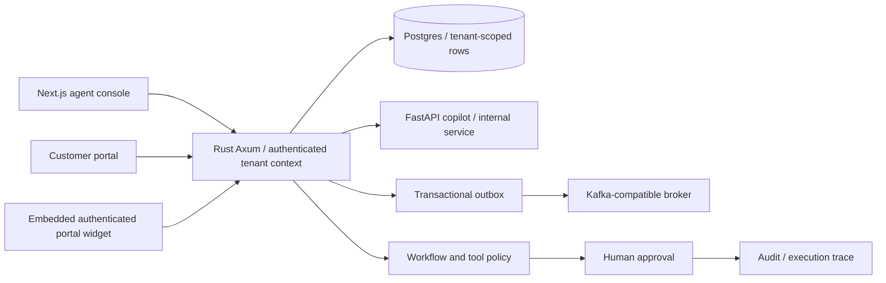
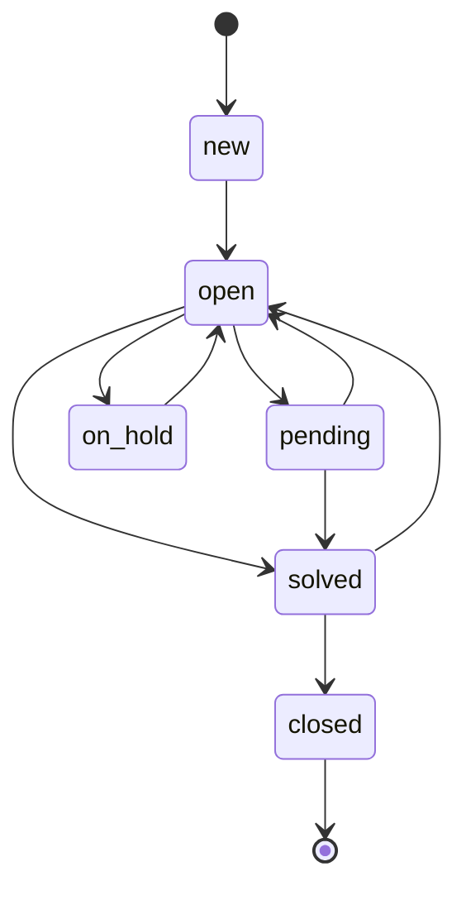

# Support OS architecture

Rust owns identity, tickets, messages, knowledge permissions, proposal approval, workflow validation/execution and metrics. Retrieval only selects fresh sources in the verified organization. Browser-supplied organization IDs never authorize access. Customer routes restrict ownership and hide internal notes. Authentication checks live user role and token version. Errors omit database details.

Portal replies and internal notes commit with audit/outbox records. Provider sending is a separate capability; storing a portal reply never proves email delivery. Workflow simulation never mutates tickets. Publishing validates every graph, and runs use a saved published version. Duplicate message/run/action keys are scoped by tenant and checked against request content.

See runbook.md for startup, failure handling and explicit operational limits. This is not a compliance certification.
